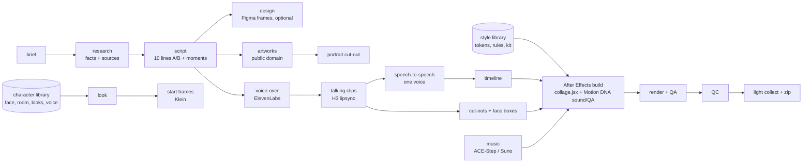
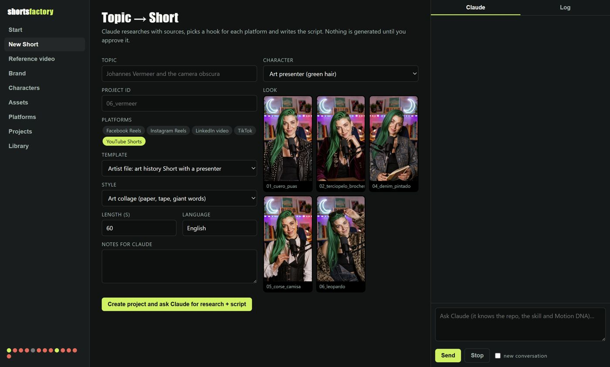

# shorts-factory

From a brief ("a Short about Odilon Redon, with the green-haired presenter, collage style") to a finished, collected vertical
video: research, script, character looks, talking clips with exact lipsync, voice, music, an After Effects build with
Motion DNA, render, QA and a light handoff. Each step is a stage that can be resumed. Claude drives it with the
`shorts-factory` skill; you choose the character, the style and the topic, and approve at a few checkpoints.

## The app
`start_app.bat` opens the desktop app (docs/APP.md): paths from a **topic**, a **reference video**, a **brand** website, a
**character** (pick, describe or let Claude propose), **assets** with local models or paid APIs, and **platform** plans, with Claude,
Motion DNA (After Effects), Blender and Figma connected, and the estimated cost shown before anything paid runs.

## What is in here
| Folder | What |
|---|---|
| `factory.py` | the command line: `new`, `run`, `status`, `stages` |
| `engine/` | one script per stage (Python; comments in Spanish, the language it was built in) |
| `ae/` | `collage.jsx` (the After Effects build of the collage style) and `collect.jsx` |
| `factory/providers/` | one interface per capability (image, video, voice, music) with local ComfyUI, ElevenLabs, Seedance, Suno and a config-described HTTP adapter |
| `library/characters/` | characters: master face, base scene, approved looks, voice, prompt texts, the never-list |
| `library/styles/` | styles: colour tokens, fonts, timings, rules, default music |
| `library/techniques/` | animation techniques with where they live in code and how they work |
| `library/templates/` | video templates: section grammar and the empty project |
| `library/kit/` | the collage kit (paper, concrete, tape, plaster hand, frames, painter's tools, halftone, craquelure) |
| `examples/` | the two finished videos as complete projects (El Bosco, Odilon Redon) |
| `app/` | the Electron app (main process, Claude Agent SDK, renderer) |
| `library/platforms/`, `library/hooks.json` | strategy per network (specs, safe areas, length, CTA, AI disclosure) and the hook catalogue, with sources |
| `library/costs.json` | the price table behind every cost estimate |
| `docs/` | architecture, app, the end-to-end recipe, style, learnings, providers, models (MiniMax H3, Z-Image, Qwen, Klein, ACE-Step, APIs), platforms, QA, Figma |
| `.claude/skills/shorts-factory/` | the skill Claude follows |

## Quick start
1. Requirements (docs/ARCHITECTURE.md › Machine): Python 3.11+, ffmpeg, After Effects with
   [Motion DNA](https://github.com/aaronamortegui-glitch/Motion_library) installed and its bridge running, ComfyUI with
   H3, Flux Klein and ACE-Step (or remote providers instead), an ElevenLabs key.
2. `copy config\local.example.json config\local.json` and edit the paths; put the keys in the `.env` it names
   (`config/.env.example`). `pip install -r requirements.txt`.
3. `python factory.py new 06_vermeer --topic "Johannes Vermeer" --character green_hair_presenter --look 02_terciopelo_broches`
4. With Claude: "make the research and the script for 06_vermeer" (the skill writes `research.md` and fills `proyecto.json`).
5. `python factory.py run 06_vermeer` (stops at any checkpoint that needs you; run it again to continue).

## Status
- Verified end to end on two videos (examples/): research by hand, everything else with these scripts. The generalized
  builder reproduces the original data exactly for both (sections, cuts, labels, subtitles).
- Seedance, Suno and generic_http adapters are written against their documented shapes but not called yet: check the
  request fields with your provider before the first paid run (docs/PROVIDERS.md).
- Voice and lipsync were measured (transcript match, LUFS, black frames), not reviewed by ear on every line.

Heavy media (clips, mattes, renders, music) is not in git: projects live in `work_dir`, and every asset can be regenerated
from its project file.
