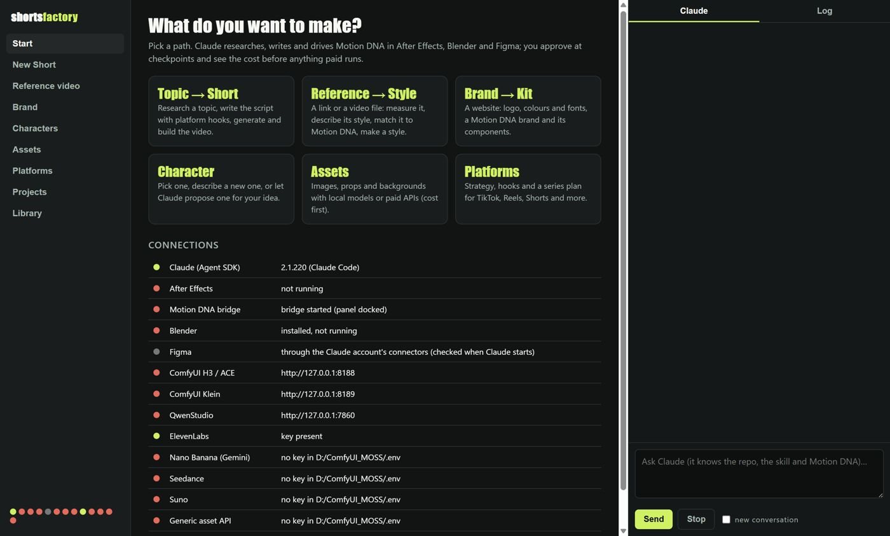

# The desktop app

`start_app.bat` (first time: `cd app && npm install`). Electron + the Claude Agent SDK: the app talks to Claude Code as logged in
on this machine, with this repo's skill, CLAUDE.md and docs, and gives it only the MCP servers in config `mcp` (Motion DNA for
After Effects, Motion DNA Blender, Figma). Tick **all my connectors** in the chat to also load the Claude account's connectors
(Krea, Flora...): heavier context, ~9x the cost of a message.

## Paths
| Path | You give | The app runs | Claude then |
|---|---|---|---|
| **Topic → Short** | topic, platforms, template, character + look, style, length, language | `factory.py new` | research with sources, hook per platform (library/hooks.json, library/platforms), script; stops for approval; then `factory.py run` |
| **Reference → Style** | a link (yt-dlp) or a video file | `engine/referencia.py`: cuts, pacing, motion energy, palette, one frame per shot | describes the style, writes a Motion DNA reference profile, runs match_reference, proposes a style file |
| **Brand → Kit** | the brand's website | `engine/marca.py`: logo candidates, colours, fonts, tagline, Motion DNA brand draft | checks it with you, creates the Motion DNA brand, builds components in AE (and Figma if asked) |
| **Characters** | pick one; describe one; or an idea to propose 3 | `engine/looks.py` for new looks | NEW_CHARACTER.md: character.json, master and scene candidates, your pick, looks |
| **Assets** | nothing to browse; a request ("5 old evidence photos"); or prompt, provider, size, refs, cut-out | shows everything the brand's videos use: the kit (props, backgrounds, loops, fx), assets, references, music and voice, and per episode the artworks and reconstructions (with their credits), start frames, the self-destruct, music takes and sound. Images open big, videos play in the player, audio plays inline. `engine/assets.py` generates (Klein, Z-Image, Qwen style, Nano Banana, generic API) | **Suggest what is missing** (reads the brand, its style and kit, lists 6-10 assets with cost, generates after your pick), **Ask** for specific assets, **More like this** on any image or video, **Ref** to use one as a reference, per-episode requests for evidence with sources; Krea and Flora through MCP |
| **Platforms** | a channel topic and platforms | — | a series plan: pillars, episodes with hooks, length and CTA per platform, repurposing |
| **Projects** | — | `factory.py run` per project, with the cost estimate first | runs and reviews with the skill |
| **Publish** | the brand's accounts, once (YouTube channel, Instagram Business, Zapier, TikTok via PostWire, GitHub release) | `engine/publicar.py` (publish copy); you run `tools/publish_release.py` | writes title, caption and hashtags, uploads to YouTube and TikTok private with the AI label, and on your OK makes them public and posts the Instagram Reel ([PUBLISHING.md](PUBLISHING.md)) |

## Where a new video starts and where it goes
Start shows this as five steps.

| Step | Where | What happens | Files |
|---|---|---|---|
| 1. Ask for it | **New Short** (or tell Claude in the side panel) | You give topic, platforms, template, character + look, style, length, language; the app runs `factory.py new` | `brands/<brand>/proyectos/<slug>/proyecto.json` |
| 2. Research + script | Claude, side panel | sources into `research.md`, hooks per platform, the script and plan into `proyecto.json`; **stops for your OK** | `research.md`, `proyecto.json` |
| 3. Generate | **Projects → Run next** (or "With Claude") | `factory.py run`: obras, visuales, retrato, look, inicios, voz, clips, sts, montaje, mates, final, musica, ae, render, qc, each leaving `.done_<stage>`; paid stages show their cost first | `clips/`, `vo/`, `mates/`, `ae/`, `<slug>_AE.mp4` |
| 4. Review and fix | **Projects** (in-app player) | a fix re-runs only what depends on it: `factory.py run <brand>/<slug> --only <stage> --force` | — |
| 5. Publish | **Publish** | [PUBLISHING.md](PUBLISHING.md) | `<slug>_pub.mp4`, `publicado.json` |

**Projects** and **Library** play videos in the app (play/pause, scrub, speed, previous/next). **Library** opens each style,
template or technique with what it is and the finished videos that used it.

## Cost before anything paid
Every paid action shows a table (stage, provider, quantity, USD, whether the price was verified) and waits for **Accept**:
`engine/costo.py` with the prices in `library/costs.json` (edit them: they are marked unverified until you check them).
`factory.py run` refuses paid stages without `--yes`; the app passes it only after you accept. Paid MCP tools (Krea, Flora) are
flagged in the permission prompt, and Claude quotes USD before using them (CLAUDE.md).

## Connections
Claude (CLI version), After Effects (process), Motion DNA bridge (`bridge/outbox/_bridge_started.txt`), Blender, Figma (from
Claude's MCP list when a conversation starts), ComfyUI H3/ACE and Klein, QwenStudio, and the keys present in the `.env`
(presence only, never values), PostWire included. The nav lists each one by name with its dot; Start has the table with what
to do when one is red. Every tool Claude wants to use that is not read-only waits for **Allow** in the chat panel.

## Self-test
`set SF_SNAPSHOT=<folder>` and start the app: it opens every view, saves a screenshot of each and the console errors, and quits.
